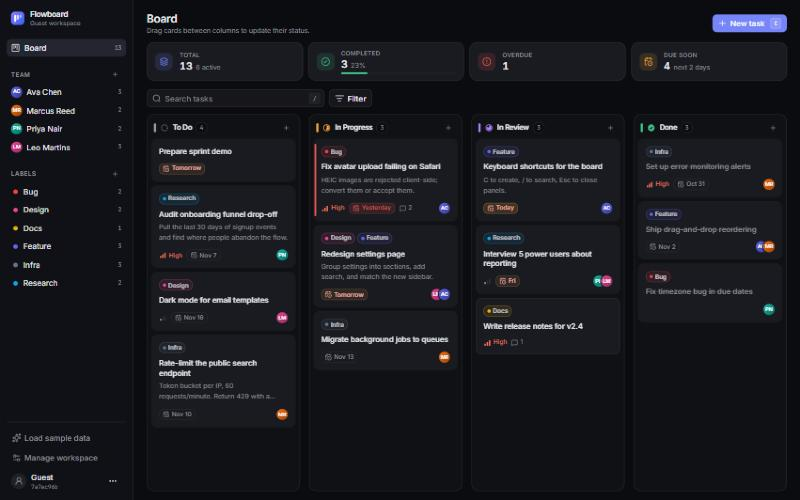
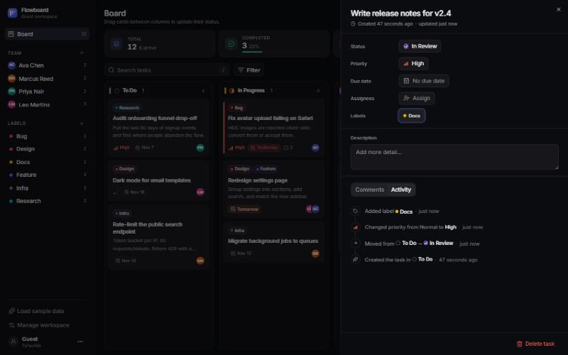
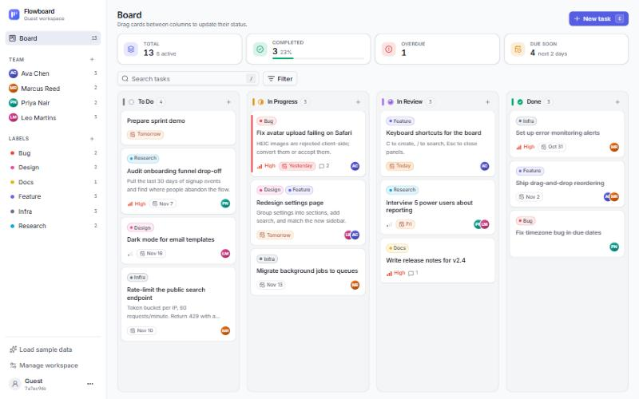
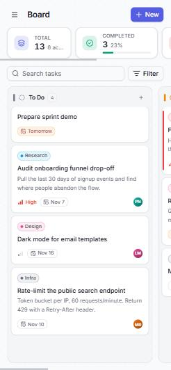

# Flowboard

A polished, Linear-inspired Kanban board. Create tasks, drag them across **To Do → In Progress → In Review → Done**, and manage work visually. Every visitor gets a private guest workspace, backed by Supabase with Row Level Security.

**Live demo:** https://flowboard-btz.pages.dev



| Task detail + activity | Light theme | Mobile |
| --- | --- | --- |
|  |  |  |

**Stack:** React 19 · TypeScript · Vite · Tailwind CSS v4 · shadcn/ui (Radix) · dnd-kit · Framer Motion · TanStack Query · Supabase (Postgres, Auth, Realtime) · Cloudflare Pages

## Features

**Board**
- Four columns with smooth drag-and-drop (mouse, touch with long-press, and keyboard: <kbd>Space</kbd> to pick up/drop, arrows to move, <kbd>Esc</kbd> to cancel)
- Reordering within a column and moving between columns, persisted with fractional positions, so a move writes a single row
- Optimistic updates with automatic rollback and a toast if the server rejects a change
- Realtime sync: open the board in two tabs and changes appear in both

**Guest accounts and security**
- A Supabase anonymous session is created automatically on first launch and persisted in the browser
- RLS on every table: guests can only read or write their own rows; join tables verify both sides belong to the same guest; the activity log is read-only for clients
- Only the public anon/publishable key ships to the browser

**Advanced features**
- **Team members and assignees:** add teammates (name + color), assign several people per task, avatar stacks on cards
- **Comments:** task detail panel with chronological, timestamped comments (separate `comments` table)
- **Activity log:** database triggers record status moves, edits, priority/due changes, assignments, labels and comments ("Moved from To Do → In Progress · 2 hours ago")
- **Labels:** custom colored labels, several per task, created inline from the picker; filter by label
- **Due date indicators:** overdue (red accent + badge), today, due soon, later
- **Search and filters:** title/description search (<kbd>/</kbd>), filters for priority, assignee (incl. unassigned), label and due status, with removable chips
- **Board summary:** total, completed with progress bar, overdue, and due soon; the last two are clickable filters
- **Sample data:** one click seeds a realistic board for exploring
- Light/dark/system theme, responsive layout (snap-scrolling columns and a drawer sidebar on phones), skeleton loading, empty and error states, keyboard shortcuts (<kbd>C</kbd> new task)

## Running locally

Requirements: Node 20+ and a free [Supabase](https://supabase.com) project.

1. **Create the database.** In the Supabase dashboard open **SQL Editor**, paste the contents of [`supabase/schema.sql`](supabase/schema.sql) and run it. The script is idempotent.
2. **Enable anonymous sign-ins.** **Authentication → Sign In / Providers → Allow anonymous sign-ins**.
3. **Configure env vars.**
   ```bash
   cp .env.example .env.local
   ```
   Fill in `VITE_SUPABASE_URL` and `VITE_SUPABASE_ANON_KEY` (the anon or `sb_publishable_…` key from **Project Settings → API Keys**). Never use the service-role key.
4. **Install and run.**
   ```bash
   npm install
   npm run dev
   ```

Other scripts:

| Command | What it does |
| --- | --- |
| `npm run build` | Type-check and build to `dist/` |
| `npm run lint` | Lint with oxlint |
| `node --env-file=.env.local scripts/verify-rls.mjs` | End-to-end RLS test: two anonymous guests try to read and modify each other's data (19 checks) |

## Project structure

```
supabase/schema.sql        Tables, indexes, RLS policies, activity triggers, realtime
scripts/verify-rls.mjs     RLS isolation test against a live project
src/
  data/                    Supabase access: auth (guest session), queries + mutations, realtime, sample data
  lib/                     Types, constants (statuses/priorities/palette), date + ordering helpers
  components/
    board/                 Board (dnd-kit), columns, cards, toolbar, filters, stats, skeleton
    task/                  Create dialog, detail sheet, pickers, comments, activity timeline
    team/                  Team + label management
    layout/                Workspace shell and sidebar
    ui/                    shadcn/ui primitives
```

## Assessment write-up

The submission document is [`docs/matthew_feyler_task_manager_assessment.pdf`](docs/matthew_feyler_task_manager_assessment.pdf). Regenerate it with `python docs/build_assessment.py` (needs Chrome or Edge).

## Deploying

The app is a static SPA. Build with `npm run build` and serve `dist/`. The live demo runs on Cloudflare Pages, and the two `VITE_*` variables are inlined at build time.
